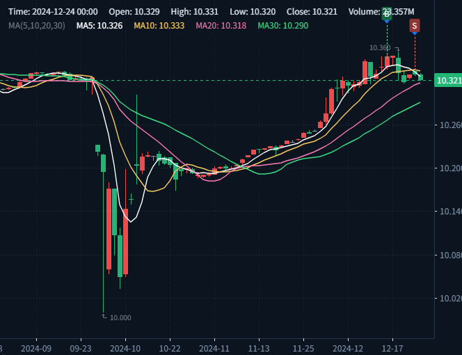

# ETF Stress Lab

**可审计的 ETF 杠杆、流动性与尾部风险压力测试研究台**

本项目研究一个受限序列决策问题：每天收盘后，模型从 ETF 候选池中排序并决定仓位；交易过程受手续费、T+1、成交量约束、融资利息和合成强平规则影响。项目比较规则动量、LightGBM、LSTM 表征、标准 PPO、CVaR-PPO 和随机基线，并检查这些方法在不同杠杆、资金规模和费用情景下的稳健性。



> 这是研究项目，不是实盘交易系统或投资建议。100x 是合成压力场景，不代表真实可获得授信；策略结果不能直接外推到真实交易。

## 这个项目回答什么

1. 时序表征是否改善 ETF 截面排序？
2. PPO 是否能在组合排序之后改善仓位控制？
3. 对尾部亏损施加 CVaR 惩罚，是否能改善高杠杆下的生存表现？
4. 费用、流动性和杠杆变化是否会改变上述结论？

项目最重要的原则是：**结果不重要，结果是否可验证、可复现、不可事后挑选更重要。**

## 核心特性

- **点时化数据**：历史成员、退市、公司行动和 `known_at`，降低幸存者偏差与未来数据泄漏；
- **AI 消融实验**：G1-G6 统一候选池、执行和费用口径，使用配对 seed；
- **执行感知回测**：raw OHLC、T+1、100 股整手、佣金、滑点、ADV、逐日利息和合成强平；
- **严格样本外评估**：按标签重叠区间 purge，冻结切分与预注册，Holdout 仅评估一次；
- **完整研究产物**：配置、摘要报告、审计 JSON、关键图表、测试和一次性 claim；
- **交互式展示**：FastAPI + Vue 3 + KLineCharts，支持 validation 回放、时间轴、持仓和压力矩阵。

## 技术栈

```text
Python 3.11+ · FastAPI · LightGBM · PyTorch · PPO · CVaR
Vue 3 · Element Plus · Pinia · KLineCharts · Vite
Pytest · YAML · NDJSON · Chrome DevTools Protocol
```

## 系统架构


详细设计、阶段边界和已知架构债务见 [docs/ARCHITECTURE.md](docs/ARCHITECTURE.md)。

```text
M0/                 可独立运行的核心 Broker 与执行协议
M1/                 点时化数据基础设施与 formal bundle
M2/
├── backend/        特征、切分、G2-G6、组合回测与 API
├── frontend/       Vue 3 交互界面
├── tests/          Python 测试与浏览器验收
└── reports/        摘要报告、审计产物和图表
docs/               架构、复现、课程答辩与发布说明
scripts/            服务管理和浏览器验收工具
```

`M0 -> M1 -> M2` 是可审计的阶段快照，允许少量代码重复，以保留每个里程碑的独立运行和冻结状态。

## 快速开始

克隆仓库后，先运行不依赖真实行情的 M0 synthetic demo：

```powershell
cd M0
python -m venv .venv
.\.venv\Scripts\python.exe -m pip install -e .
.\.venv\Scripts\python.exe -m backend.engine.run_backtest `
  --config config.yaml `
  --output reports/runs/m0_demo
.\.venv\Scripts\python.exe -m pytest -q -p no:cacheprovider
```

结果写入 `M0/reports/runs/m0_demo`，包括成交、每日快照、目标组合、费用和审计事件。

完整 API/前端需要 M1 正式 bundle 与 M2 派生数据。GitHub 源码仓库不包含约 8.6 GB 的本地缓存、完整行情和中间面板。

当前 Windows 一键入口：

```powershell
.\快速启动关闭.bat start
.\快速启动关闭.bat status
```

页面地址：`http://127.0.0.1:8000/`

完整环境、数据恢复和测试命令见 [docs/REPRODUCIBILITY.md](docs/REPRODUCIBILITY.md)。

## 验证状态

| 模块 | 状态 |
| :--- | :--- |
| M0 Broker 与执行协议 | `40 passed` |
| M1 点时化数据层 | `92 passed` |
| M2 特征、切分、模型与 API | `119 passed` |
| Vue 生产构建 | passed |
| KLine Chrome/CDP 交互验收 | passed，Console/Log events `0` |
| final Holdout | evaluated once，禁止重跑 |

## 主要结果

以下结果用于说明实验设计，不构成收益承诺：

- G3 相对 G2 的平均 Rank IC 从 `0.0974` 提高到 `0.1020`，配对 95% 区间为 `[0.0030, 0.0062]`；
- G3 的 Top5 平均超额收益相对 G2 有正向配对区间，但 Top20 precision 区间跨 0；
- 50x / 100 万 / base 的最终 Holdout 主比较中，G4 与 G6 没有显著差异；
- 因此不能宣称 CVaR reward shaping 在所有高杠杆场景中改善生存表现。

负结果同样是项目交付的一部分。完整解释见 [M2/reports/final_holdout_report.md](M2/reports/final_holdout_report.md) 和 [M2/reports/g2_g3_validation_report.md](M2/reports/g2_g3_validation_report.md)。

## 课程设计

如果本项目用于人工智能课程期末设计，建议把答辩重点放在“模型消融、无数据泄漏和统计评估”，而不是收益率。

已整理：

- 面向非金融背景听众的术语解释；
- 10 分钟答辩结构；
- 结果表述边界和常见追问；
- 60 秒现场演示流程。

见 [docs/COURSE_DESIGN.md](docs/COURSE_DESIGN.md)。

## 数据与公开仓库

以下内容不会提交到 Git：

- Python 虚拟环境、`node_modules`、构建目录和运行日志；
- M1 全市场缓存与 raw 行情；
- M2 特征、标签、建模面板、模型权重和 Holdout 行数据；
- 可重新生成的 `reports/runs`。

公开仓库保留源码、测试、小型 fixture、冻结 split 配置、一次性 claim、摘要报告和关键图表。根目录 [.gitignore](.gitignore) 已按这些边界配置。

## 研究边界

- `financing_mode=synthetic_stress`，不是真实券商融资；
- `liquidation_model=synthetic_v1`，不是真实保证金合同；
- 费用是参数化研究假设，不是券商历史账单；
- raw OHLC 用于执行，点时化 total-return 价格只用于特征和收益；
- 主生存实验在首次强平后终止，未强平路径属于右截尾；
- final Holdout 已消费，不能因结果不符合预期而重跑；
- 本项目不接入实盘下单，也不构成投资建议。

## 文档

- [系统架构](docs/ARCHITECTURE.md)
- [复现指南](docs/REPRODUCIBILITY.md)
- [课程设计答辩指南](docs/COURSE_DESIGN.md)
- [GitHub 发布清单](docs/PUBLISHING.md)
- [数据、许可证与风险声明](NOTICE.md)
- [完整使用手册](使用手册.md)
- [研究口径简报](项目简报.md)
- [前端验收记录](M2/tests/test_frontend.md)

## License

本项目源码采用 [MIT License](LICENSE)。MIT 许可证仅覆盖本仓库中的原创代码和文档，不替代行情数据、交易所规则或第三方依赖各自的授权条款。发布与大文件策略见 [docs/PUBLISHING.md](docs/PUBLISHING.md)。

