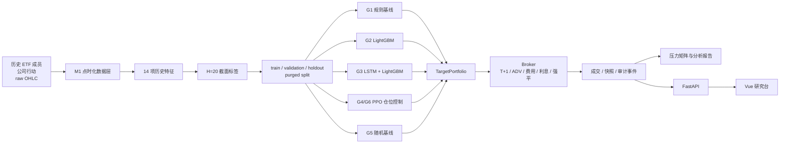
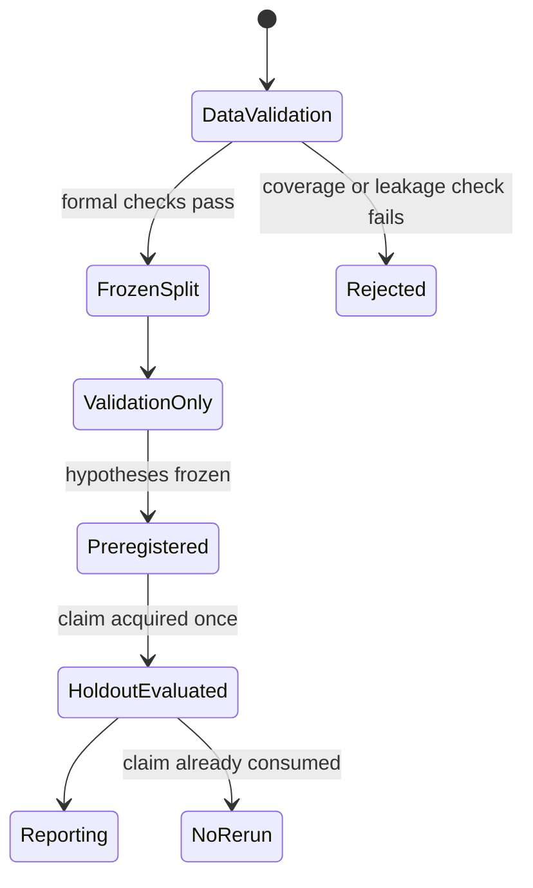

# 系统架构

## 1. 定位

本项目是一个面向研究复现的 ETF 杠杆与尾部风险压力测试工作台。它有三个相互独立的目标：

1. 用点时化数据构造无未来信息泄漏的 ETF 决策样本；
2. 在同一执行和费用口径下比较规则、监督学习、深度表征和强化学习；
3. 用可审计的回放、压力矩阵和前端视图解释结果。

它不是实盘交易系统，也不提供真实券商授信、行情推送或下单接口。

## 2. 端到端数据流



## 3. 分阶段架构

### M0：可执行核心

```text
M0/backend/
├── data_pipeline/   数据契约、点时化视图、合成 fixture
└── engine/          TargetPortfolio、Broker、账本、费用、强平、G1
```

M0 是可独立运行的最小闭环。端到端测试使用确定性 synthetic fixture，不依赖网络或真实行情。

核心设计：

- 策略层只能输出 `TargetPortfolio(total_r, weights, ...)`；
- Broker 独占资金、股数、债务、费用和账户状态解释权；
- 成交与强平只使用未复权 raw OHLC；
- 所有金额使用 Decimal，避免账本浮点误差；
- 首次强平终止主生存实验，资不抵债账户永久终止。

### M1：点时化数据基础设施

```text
M1/backend/
├── data_pipeline/
│   ├── provider / storage       数据源和落盘
│   ├── historical_membership   历史成员与退市
│   ├── corporate_action*       公司行动及 known_at
│   ├── trading_rule*           T+0/T+1、涨跌停规则
│   ├── build_total_return      点时化总收益链
│   ├── formal_gate             正式研究准入
│   └── build_formal_bundle     不可变研究数据包
└── engine/                     继承并验证 M0 执行核心
```

M1 将“当前 ETF 列表”与“历史可交易成员”分离，避免幸存者偏差。数据质量不足时，formal gate 会阻止真实研究。

关键契约：

- `known_at <= data_cutoff` 的信息才可以进入特征；
- raw OHLC 用于交易执行，total-return 价格只用于特征和收益；
- 交易规则必须按代码和生效区间给出；
- formal bundle 带内容哈希和 manifest。

### M2：AI 研究、回放与展示

```text
M2/
├── backend/
│   ├── features/     特征和 H=20 标签
│   ├── split/        purge、冻结切分与 Holdout claim
│   ├── models/       G2-G6、CVaR、PPO 与验证
│   ├── engine/       组合回测、生存分析和压力矩阵
│   └── api/          FastAPI 只读查询与 validation 回放
├── frontend/         Vue 3 + Element Plus + KLineCharts
├── tests/            Python 与前端验收
└── reports/          摘要报告、审计 JSON 和研究图表
```

M2 使用冻结切分和预注册比较。API 不负责训练模型，也不会通过前端触发 Holdout 重跑。

## 4. 决策模型分组

| 组别 | 输入 | 决策层 | 研究问题 |
| :--- | :--- | :--- | :--- |
| G1 | 历史价格 | 规则动量 | 传统基线表现 |
| G2 | 截面特征 | LightGBM 排序 | 监督学习是否改善 ETF 排序 |
| G3 | 截面 + 时序特征 | LSTM 表征 + LightGBM | 深度时序表征是否带来增量 |
| G4 | G3 组合分数 | 标准 PPO | RL 能否改善仓位控制 |
| G5 | 无模型信息 | 随机决策 | 排除运气和基线偏差 |
| G6 | G3 组合分数 | CVaR-PPO | 尾部风险惩罚是否改善生存 |

所有组共享候选池、费用、T+1、ADV、整手与强平口径。G4/G6 使用相同网络和训练预算，仅改变风险奖励。

## 5. 研究状态与安全门



规则：

- Holdout 边界、指标和主比较必须在评估前冻结；
- claim 一旦消费，不删除、不重建、不重跑；
- 前端只查看 validation 回放和冻结 Holdout 摘要；
- 隐藏负结果不构成可接受的科研或工程实践。

## 6. 目录职责

| 路径 | 是否进入 GitHub | 职责 |
| :--- | :---: | :--- |
| `M0/backend`, `M1/backend`, `M2/backend` | 是 | 核心源码 |
| `M*/tests` | 是 | 测试与验收记录 |
| `M*/config.example.yaml` | 是 | 可公开配置模板 |
| `M2/frontend/src` | 是 | 前端源码 |
| `M2/reports` | 是 | 摘要报告和关键图表 |
| `M2/data/splits/*.json` | 是 | 冻结计划和 claim 证据 |
| `M1/data/fixtures`, `M0/data/fixtures` | 是 | 小型确定性样例 |
| `M1/data/m1_2`, `M2/data/features`, `M2/data/modeling` | 否 | 大型派生数据 |
| `.venv`, `node_modules`, `.runtime` | 否 | 本地环境 |
| `reports/runs` | 否 | 可重新生成的运行输出 |

大型数据不直接进入 Git。复现时需要从研究归档或数据生成流程恢复，详见
[REPRODUCIBILITY.md](REPRODUCIBILITY.md)。

## 7. 已知架构债务

当前按 `M0 -> M1 -> M2` 保存阶段快照，部分 Broker 和数据管道代码在阶段目录中重复。这是为了保证每个里程碑可以独立审计，不应被误解为一个已经完成发布打包的统一库。

公开版本发布后，建议下一步抽取：

```text
packages/etfstress-core/
packages/etfstress-data/
packages/etfstress-research/
apps/dashboard/
examples/
```

抽取必须在不改变 M0/M1/M2 冻结产物的前提下逐步进行，不能为了目录美观重写研究结果。

